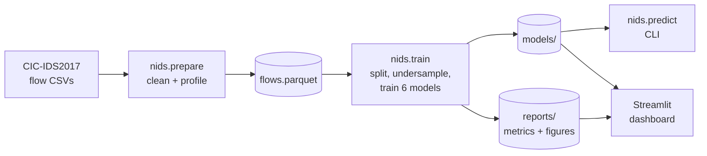

# AI-Based Network Intrusion Detection System Using Machine Learning

A network intrusion detection system (NIDS) that classifies network flows as **benign** or as
one of seven **attack categories**. It trains and compares six machine-learning models on the
**CIC-IDS2017** dataset and ships an interactive **Streamlit dashboard** for analysis, file-based
detection and simulated live monitoring.

**Research question.** Models trained on CIC-IDS2017 routinely report ~99.9% detection. This
project measures how much of that survives a realistic evaluation (attack families and days the
model never saw, without shortcut features) and proposes a **hybrid, conformally calibrated
detector** that catches more unseen attacks within a fixed false-alarm budget. See
[Research experiments](#5-research-experiments).

## Features

- **Data pipeline** for the raw CIC-IDS2017 CSV files: header repair, label-encoding fixes,
  removal of NaN/infinite values and duplicate flows, and attack-category mapping.
- **Two detection tasks**
  - *Binary*: benign vs attack (anomaly alarm).
  - *Multi-class*: Benign, DoS, DDoS, PortScan, BruteForce, WebAttack, Botnet, Infiltration.
- **Six models compared**: Logistic Regression, Decision Tree, Random Forest, K-Nearest
  Neighbors, XGBoost and a Multi-Layer Perceptron neural network.
- **Evaluation for an IDS**: accuracy, macro precision/recall/F1, MCC, detection rate,
  false-alarm rate, ROC AUC, confusion matrices, per-class reports, feature importance,
  training and inference time.
- **Report-ready outputs**: PNG figures, CSV/Markdown result tables and JSON metrics.
- **Dashboard** with six pages: Overview, Dataset Explorer, Model Performance, Research
  Findings, Traffic
  Analyzer (upload a CSV, get predictions) and Live Monitor (real-time replay with alerts and a
  rotating globe that draws each detected attack as an arc to the protected network; the dataset
  has no attacker locations, so arc origins are random and labelled as such).
- **Command-line detection** on any CICFlowMeter-format CSV.
- **Automated tests** that run the whole pipeline on synthetic data.

## Architecture



## 1. Installation

Requires Python 3.10 or newer (developed on 3.13) and about 8 GB of free RAM for the full dataset.

```bash
python -m venv .venv
```

```bash
.venv\Scripts\activate
```

(On Linux/macOS: `source .venv/bin/activate`.)

```bash
pip install -r requirements.txt
```

## 2. Get the dataset

CIC-IDS2017 is published by the Canadian Institute for Cybersecurity, University of New Brunswick.

1. Request access at <https://www.unb.ca/cic/datasets/ids-2017.html>.
2. Download **`MachineLearningCSV.zip`** (about 225 MB; 844 MB extracted).
3. Extract the 8 CSV files into `data/raw/` (sub-folders are fine).

The `GeneratedLabelledFlows` variant also works: its IP/port/timestamp columns are dropped
automatically. Do not mix files from both variants.

## 3. Run the pipeline

All commands run from the project root.

**Step 1: clean the data** (a few minutes; writes `data/processed/`)

```bash
python -m nids.prepare
```

**Step 2: train and evaluate** (roughly 20-40 minutes on a 6-core CPU; writes `models/` and `reports/`)

```bash
python -m nids.train
```

Useful options: `--quick` trains on small samples for a fast trial run, `--tasks multiclass`
trains a single task, and `--models random_forest xgboost` trains a subset of models.

```bash
python -m nids.train --quick
```

**Step 3: open the dashboard**

```bash
streamlit run dashboard/app.py
```

**Detect intrusions in a CSV file from the command line**

```bash
python -m nids.predict --input data/raw/Friday-WorkingHours-Afternoon-DDos.pcap_ISCX.csv --output ddos_predictions.csv
```

Add `--task binary` for benign/attack only, or `--model xgboost` to pick a model (default: the
best model). If the file has a `Label` column, the accuracy against it is printed.

## 4. Methodology

### Data cleaning (`nids/data.py`)

| Step | Why |
|---|---|
| Strip spaces from column names | The original headers start with a space (`" Flow Duration"`). |
| Read as latin-1 and repair labels | The web-attack labels contain cp1252 en-dashes that break UTF-8 decoding. |
| Drop identifier columns | `Flow ID`, IPs, source port and timestamp describe *who*, not *how*; models would memorise hosts instead of behaviour. |
| Drop `Fwd Header Length.1` | An exact duplicate of `Fwd Header Length`. |
| Remove rows with NaN or infinite values | `Flow Bytes/s` and `Flow Packets/s` are undefined for zero-duration flows. |
| Remove duplicate flows | Duplicates would land in both the training and test sets and inflate scores. |
| Remove constant features (in the model pipeline) | 8 columns are always zero and carry no information. |

### Attack categories

The 15 original labels are grouped into 8 categories, following the common practice in the
literature (rare classes such as SQL injection with only ~21 flows cannot be learned on their
own). The mapping lives in `config.yaml` and can be changed.

| Category | Original labels |
|---|---|
| Benign | BENIGN |
| DoS | DoS Hulk, DoS GoldenEye, DoS slowloris, DoS Slowhttptest, Heartbleed |
| DDoS | DDoS |
| PortScan | PortScan |
| BruteForce | FTP-Patator, SSH-Patator |
| WebAttack | Web Attack – Brute Force, Web Attack – XSS, Web Attack – Sql Injection |
| Botnet | Bot |
| Infiltration | Infiltration |

### Train/test protocol (`nids/train.py`)

1. **Stratified 80/20 split** by category, so every attack type appears in both sets.
2. **Undersampling of the training set only**: at most 400,000 benign flows and 150,000 flows per
   attack category. This keeps training fast and stops the ~80% benign majority from dominating.
3. The **test set keeps the real class distribution**, so the reported false-alarm rate reflects
   realistic traffic.
4. Every model is a scikit-learn `Pipeline`, so exactly the same preprocessing is applied at
   training and at inference time:
   - all models: drop constant features;
   - Logistic Regression, KNN, MLP: `sign(x)·log(1+|x|)` transform (flow statistics span ~10
     orders of magnitude), then standardisation;
   - tree models (Decision Tree, Random Forest, XGBoost) use raw values, since they are
     insensitive to scale.
5. The **best model per task** is selected by **macro F1**, which weights every class equally
   (accuracy alone would reward a model that ignores rare attacks).

### Models

| Model | Role in the comparison |
|---|---|
| Logistic Regression | Linear baseline |
| Decision Tree | Interpretable rule-based model |
| Random Forest | Bagged tree ensemble |
| K-Nearest Neighbors | Instance-based learner (fit on a 50,000-flow subsample) |
| XGBoost | Gradient-boosted tree ensemble |
| MLP (128-64) | Feed-forward neural network with early stopping |

### Metrics

- **Detection rate** (recall on attacks): share of attack flows raised as any attack.
- **False alarm rate** (false-positive rate): share of benign flows wrongly flagged.
- **Macro precision / recall / F1**: per-class averages, sensitive to rare attacks.
- **MCC**: Matthews correlation coefficient, robust to class imbalance.
- **ROC AUC**: attack vs benign, scored as 1 − P(benign).

## 5. Research experiments

```bash
python -m nids.experiments
```

Takes about an hour on a 6-core CPU (`--quick` for a few-minute trial, `--only loao` to rerun one
experiment). Writes `reports/research/results.json`, `summary.md` and `figures/`; the dashboard's
**Research Findings** page reads the same file.

| Experiment | Question | Protocol |
|---|---|---|
| E1 random split | What does the usual setup report? | Stratified 80/20 split, as in most papers |
| E2 temporal | Does the model work on later traffic? | Train on Monday–Wednesday, test on Thursday–Friday: every test attack type is new |
| E3 leave one family out | Can it detect a zero-day attack? | Each of the 7 attack families in turn is removed from training and tested on |
| E4 TreeSHAP | What is the model really relying on? | Share of each decision coming from candidate shortcut features |

Every experiment runs on three feature sets: all features; without `Destination Port`, a known
shortcut (D'hooge et al., DIMVA 2022); and also without the TCP initial window sizes
(`Init_Win_bytes_forward/backward`), which depend on each host's operating system and may
fingerprint the testbed's machines.

**Detectors compared** (binary, XGBoost and Random Forest):

- *Supervised, threshold 0.5*: what is usually reported.
- *Supervised, calibrated*: the same model with its threshold set for a fixed alarm budget.
- *Anomaly detectors* (`nids/anomaly.py`): Isolation Forest and an autoencoder, trained on
  benign traffic only, so they need no examples of an attack.
- *Hybrid (proposed)*: alarm when either the supervised model or an anomaly detector finds the flow
  suspicious.

**Calibration.** Thresholds use conformal p-values computed on held-out benign flows: a flow is
flagged when fewer than α = 1% of benign calibration flows look as suspicious, which bounds the
false-alarm rate at α for benign traffic like the calibration set. The hybrid gives each part
α/2, so the union bound keeps it within α. Because benign traffic itself shifts between days,
the temporal experiment also re-calibrates on a small sample of recent benign flows.

## 6. Outputs

| Path | Contents |
|---|---|
| `data/processed/flows.parquet` | Cleaned dataset |
| `data/processed/profile.json` | Row counts, class distribution, feature statistics |
| `models/<task>/<model>.joblib` | Trained pipelines |
| `models/<task>/metadata.json` | Feature list, classes, best model |
| `reports/<task>/results.md` | Comparison table, ready for the report |
| `reports/<task>/metrics.csv` / `metrics.json` | All metrics, confusion matrices, per-class reports |
| `reports/<task>/figures/` | Model comparison, ROC curves, confusion matrices, feature importance |

## 7. Project structure

```
├── config.yaml              # all settings: paths, label mapping, sampling, hyper-parameters
├── requirements.txt
├── nids/                    # core package
│   ├── config.py            # configuration loading
│   ├── data.py              # CSV loading, cleaning, label mapping, profiling
│   ├── prepare.py           # CLI step 1: python -m nids.prepare
│   ├── models.py            # model pipelines
│   ├── evaluate.py          # metrics and report figures
│   ├── train.py             # CLI step 2: python -m nids.train
│   ├── predict.py           # IntrusionDetector class + CLI: python -m nids.predict
│   ├── anomaly.py           # anomaly detectors + conformal calibration
│   ├── experiments.py       # research experiments: python -m nids.experiments
│   └── research_report.py   # research tables (summary.md) and figures
├── .streamlit/config.toml   # dashboard theme (colours, fonts) and server settings
├── dashboard/
│   ├── app.py               # streamlit run dashboard/app.py
│   ├── common.py            # shared loaders, theme tokens, category colours
│   ├── attack_globe.py/.js  # rotating globe on the live monitor (globe.gl)
│   ├── static/fonts/        # self-hosted Barlow fonts (SIL OFL), work offline
│   ├── static/vendor/       # globe.gl, topojson-client, world map (MIT / ISC licences)
│   └── views/               # the six dashboard pages
├── tests/                   # pytest suite + synthetic data generator
├── data/raw/                # put CIC-IDS2017 CSVs here
├── data/processed/          # generated
├── models/                  # generated
└── reports/                 # generated
```

## 8. Tests

The test suite generates a small synthetic dataset that reproduces the real files' quirks
(padded headers, duplicated column, cp1252 labels, inf/NaN values, duplicate and empty rows) and
runs prepare → train → predict end to end in under a minute.

```bash
python -m pytest
```

Synthetic data only proves the code works; its scores say nothing about real traffic. Anything
produced from it is labelled "synthetic", and the dashboard shows a warning.

## 9. Limitations and future work

- **Dataset quality**: Engelen et al. (2021), *Troubleshooting an Intrusion Detection Dataset:
  the CICIDS2017 Case Study*, documented labelling and flow-construction errors in the original
  release. A corrected version of the dataset can be dropped in with the same pipeline.
- **Rare classes**: Infiltration (~36 flows) and some web attacks have too few examples for
  reliable detection; the per-class report shows this honestly.
- **Live capture**: the live monitor replays held-out flows. Capturing real traffic would need a
  flow exporter such as CICFlowMeter producing the same features.
- **Generalisation**: models trained on one network may not transfer to another; cross-dataset
  evaluation (e.g. CSE-CIC-IDS2018) would measure this.
- **Explainability**: SHAP values could explain individual alerts to analysts.
