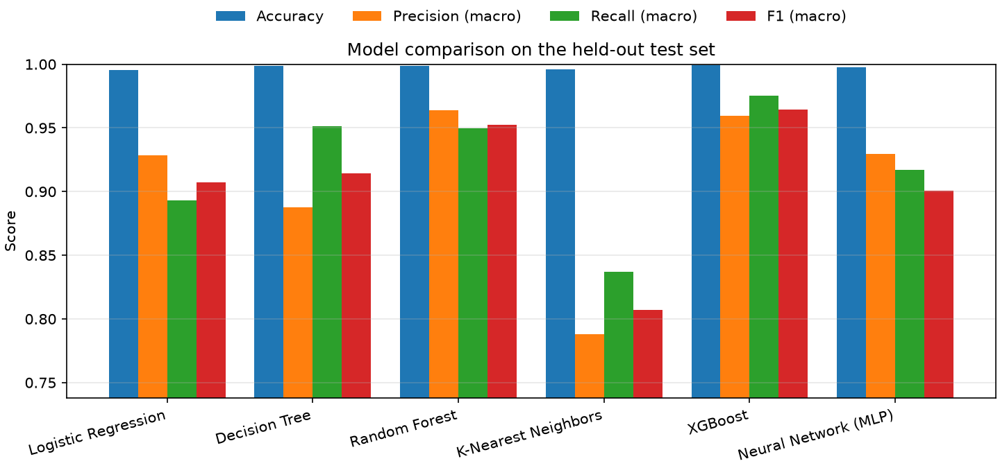
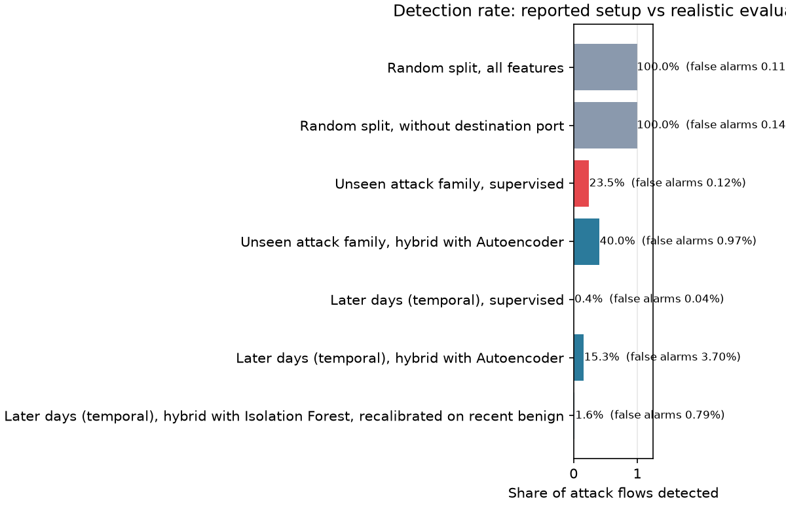
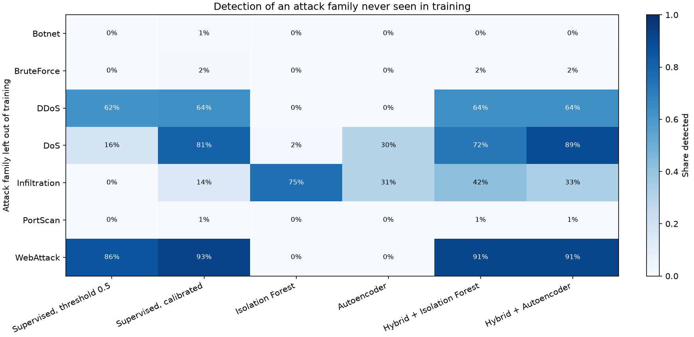
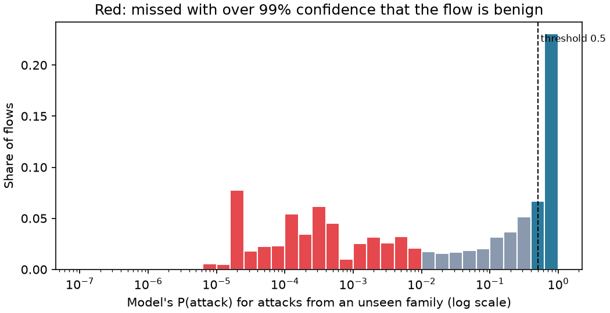
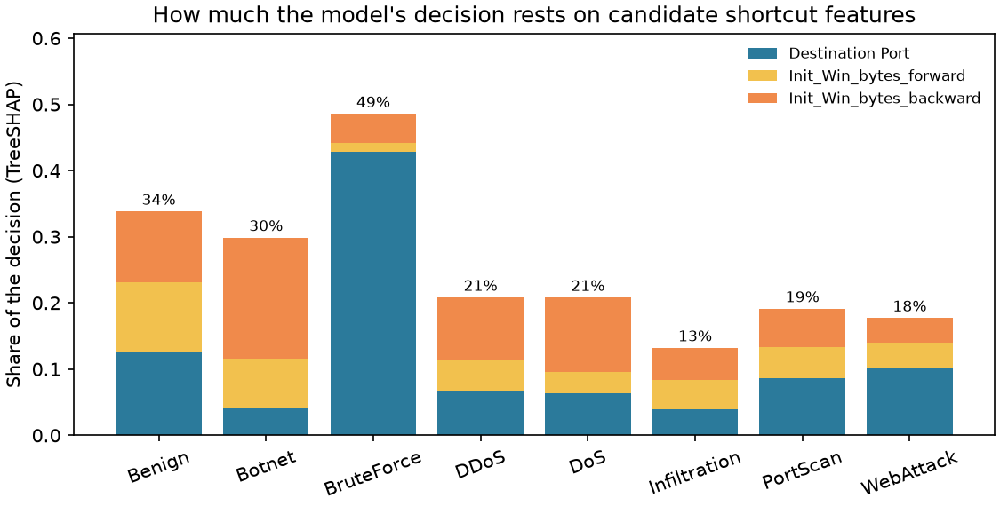

# تقرير مشروع التخرج: نظام كشف التسلل الشبكي المعتمد على تعلم الآلة

**AI-Based Network Intrusion Detection System Using Machine Learning**

يوثّق هذا التقرير كل ما أُنجز في المشروع حتى الآن: تجهيز البيئة، ومعالجة البيانات، وتدريب النماذج، ولوحة التحكم وتصميمها، ثم الجزء البحثي الذي يمثل المساهمة العلمية للمشروع، ونتائجه.

---

## الملخص التنفيذي

- بنينا نظاماً كاملاً لكشف التسلل الشبكي (NIDS) يصنّف تدفقات الشبكة (network flows) إلى حركة طبيعية أو أحد سبعة أنواع من الهجمات، مدرَّباً على مجموعة البيانات **CIC-IDS2017** (نحو 2.5 مليون تدفق بعد التنظيف).
- قارنّا ستة نماذج تعلم آلة. أفضلها **XGBoost**: دقة 99.91%، ونسبة كشف هجمات 99.97%، وإنذارات كاذبة 0.10% في التقسيم العشوائي المعتاد.
- لاحظنا أن هذه الأرقام هي ما تنشره معظم الأوراق، وأن الأدبيات الحديثة تشكك فيها. فحوّلنا المشروع إلى سؤال بحثي: **كم يبقى من 99.9% عند تقييم واقعي؟ وهل يمكن كشف هجمات لم يرها النموذج من قبل؟**
- صممنا أربع تجارب وكاشفاً هجيناً مقترحاً بعتبات معايَرة إحصائياً (Conformal Calibration). أبرز النتائج ([القسم 10](#10-النتائج-البحثية)):
  - الكشف ينهار من 99.98% إلى **23.5%** عند هجوم من عائلة لم يرها النموذج، وإلى **0.4%** على أيام لاحقة.
  - المعايرة والكاشف الهجين يرفعان كشف العائلات غير المعروفة إلى **40.0%** ضمن ميزانية إنذارات كاذبة 1%.
  - ميزتا نافذة TCP تعملان كاختصار: حذفهما رفع الكشف في التقسيم الزمني من 0.4% إلى 23.8%.
- بنينا لوحة تحكم تفاعلية بست صفحات، منها مراقبة حية مع خريطة عالم وكرة أرضية تعرضان الهجمات المكتشفة، وصفحة لعرض النتائج البحثية.

---

## 1. المقدمة والأهداف

أنظمة كشف التسلل الشبكي خط دفاع أساسي ضد الهجمات. الأنظمة التقليدية تعتمد على التواقيع (signatures)، فلا تكتشف إلا الهجمات المعروفة مسبقاً. تعلم الآلة يعد بتعلم سلوك الهجمات من البيانات.

**أهداف المشروع:**
1. بناء خط معالجة كامل لبيانات CIC-IDS2017، من الملفات الخام إلى بيانات نظيفة جاهزة للتدريب.
2. تدريب ستة نماذج ومقارنتها على مهمتين: ثنائية (طبيعي/هجوم) ومتعددة الفئات (نوع الهجوم).
3. بناء لوحة تحكم تفاعلية لعرض النتائج ومحاكاة المراقبة الحية.
4. (المساهمة البحثية) تقييم واقعي لأداء النماذج، واقتراح كاشف يكتشف الهجمات غير المعروفة ضمن ميزانية محددة للإنذارات الكاذبة.

---

## 2. البيئة والأدوات

| العنصر | الإصدار / التفاصيل |
|---|---|
| نظام التشغيل | Windows 10 Pro، معالج AMD Ryzen 5 3600 (6 أنوية)، ذاكرة 12 GB |
| لغة البرمجة | Python 3.13، داخل بيئة افتراضية `.venv` |
| معالجة البيانات | pandas 3.1، numpy 2.5، pyarrow (تخزين Parquet) |
| تعلم الآلة | scikit-learn 1.9.1، XGBoost 3.4.1 |
| الرسوم | matplotlib 3.11 (صور التقرير)، plotly 7.1 (رسوم تفاعلية) |
| لوحة التحكم | Streamlit 1.66 |
| الكرة والخريطة | globe.gl 2.46 وtopojson-client وبيانات world-atlas، كلها محفوظة داخل المشروع |
| الاختبارات | pytest (18 اختباراً) |

**ملاحظة عن البيئة:** سرعة الإنترنت كانت منخفضة جداً (نحو 30 إلى 120 كيلوبايت/ثانية)، فاستغرق تنزيل مكتبة XGBoost وحدها (49 ميغابايت) قرابة 17 دقيقة. لذلك:
- جعلنا كل ما تحتاجه اللوحة محلياً: الخطوط، ومكتبة الكرة الأرضية، وبيانات الخريطة. فاللوحة تعمل في قاعة المناقشة حتى بدون إنترنت.
- تجنبنا المكتبات الثقيلة، مثل TensorFlow وPyTorch ومكتبة SHAP. التفسير بـ SHAP يُحسب مباشرة من XGBoost عبر TreeSHAP المدمج فيها.

---

## 3. مجموعة البيانات CIC-IDS2017

نشرها المعهد الكندي للأمن السيبراني (CIC) في جامعة New Brunswick. سُجّلت حركة شبكة حقيقية على مدى خمسة أيام عمل (3 إلى 7 يوليو 2017)، ونُفّذت خلالها هجمات مخطط لها، ثم حُوّلت الحركة إلى تدفقات بأداة CICFlowMeter، لكل تدفق 78 ميزة إحصائية وتسمية (Label). استخدمنا نسخة **MachineLearningCSV**، وهي ثمانية ملفات حجمها نحو 844 ميغابايت.

### 3.1 توزيع الهجمات على الأيام (بعد التنظيف)

| اليوم | حركة طبيعية | الهجمات |
|---|---|---|
| الاثنين | 502,573 | لا هجمات |
| الثلاثاء | 404,984 | BruteForce: 9,150 (FTP وSSH) |
| الأربعاء | 400,452 | DoS: 193,741 (Hulk، GoldenEye، slowloris، Slowhttptest، Heartbleed) |
| الخميس | 392,007 | WebAttack: 2,143، Infiltration: 36 |
| الجمعة | 372,238 | DDoS: 128,014، PortScan: 90,694، Botnet: 1,948 |

**ملاحظة مهمة:** كل نوع هجوم يقع في يوم مختلف. هذه الخاصية هي أساس تجربة التقسيم الزمني في الجزء البحثي.

### 3.2 تجميع التسميات في فئات

التسميات الأصلية 15. جمعناها في 8 فئات وفق الممارسة الشائعة في الأدبيات، لأن بعض الفئات نادرة جداً (مثلاً SQL Injection: 21 تدفقاً، وHeartbleed: 11):

| الفئة | التسميات الأصلية (عدد التدفقات بعد التنظيف) |
|---|---|
| Benign | BENIGN (2,072,254) |
| DoS | DoS Hulk (172,846)، DoS GoldenEye (10,282)، DoS slowloris (5,374)، DoS Slowhttptest (5,228)، Heartbleed (11) |
| DDoS | DDoS (128,014) |
| PortScan | PortScan (90,694) |
| BruteForce | FTP-Patator (5,931)، SSH-Patator (3,219) |
| WebAttack | Brute Force (1,470)، XSS (652)، SQL Injection (21) |
| Botnet | Bot (1,948) |
| Infiltration | Infiltration (36) |

---

## 4. معالجة البيانات (`nids/data.py`)

| الخطوة | السبب | الأثر |
|---|---|---|
| حذف المسافات من أسماء الأعمدة | العناوين الأصلية تبدأ بمسافة (`" Flow Duration"`) | أسماء أعمدة موحدة |
| القراءة بترميز latin-1 وإصلاح التسميات | تسميات هجمات الويب تحتوي شرطة (–) بترميز cp1252 لا يُقرأ كـ UTF-8 | تسميات صحيحة مثل "Web Attack - XSS" |
| حذف أعمدة التعريف (IP، المنافذ المصدر، الوقت) إن وُجدت | تصف من هو الجهاز لا كيف يتصرف، فيحفظها النموذج بدل أن يتعلم | — |
| حذف العمود المكرر `Fwd Header Length.1` | نسخة طبق الأصل من `Fwd Header Length` | 77 ميزة بدل 78 |
| حذف الصفوف التي فيها NaN أو قيم لا نهائية | `Flow Bytes/s` غير معرّفة للتدفقات ذات المدة صفر | حُذف 2,867 صفاً |
| حذف التدفقات المكررة | لو بقيت لظهرت النسخة نفسها في التدريب والاختبار فتضخّم النتائج | حُذف 329,896 تدفقاً |
| تسجيل يوم التسجيل لكل تدفق | شرط لتجربة التقسيم الزمني | عمود `Day`؛ والتكرار يحتفظ بأول ظهور زمنياً |
| حذف الميزات الثابتة (داخل خط التدريب) | ثماني ميزات قيمتها صفر دائماً، مثل `Bwd PSH Flags` | 69 ميزة فعلية للنموذج |

**الحصيلة:** من 2,830,743 صفاً مقروءاً إلى **2,497,980 تدفقاً نظيفاً**، 17% منها هجمات. تُحفظ النتيجة في ملف Parquet مع ملف وصفي `profile.json`، وتستغرق المعالجة الكاملة نحو 35 ثانية.

---

## 5. النماذج والتدريب (`nids/models.py`، `nids/train.py`)

### 5.1 بروتوكول التدريب
1. **تقسيم طبقي 80/20** حسب الفئة، فيظهر كل نوع هجوم في التدريب والاختبار.
2. **تقليل عينات التدريب فقط (undersampling):** حد أقصى 400,000 تدفق طبيعي و150,000 لكل فئة هجوم. هذا يسرّع التدريب ويمنع الحركة الطبيعية (83%) من السيطرة على التعلم. حجم التدريب النهائي 735,588 تدفقاً.
3. **مجموعة الاختبار تحافظ على التوزيع الحقيقي** (499,596 تدفقاً، 83% منها طبيعي)، فتعكس نسبة الإنذارات الكاذبة الواقع.
4. كل نموذج عبارة عن Pipeline من scikit-learn، فالمعالجة نفسها تُطبَّق في التدريب والاستخدام:
   - **كل النماذج:** حذف الميزات الثابتة.
   - **Logistic Regression وKNN وMLP:** تحويل لوغاريتمي `sign(x)·log(1+|x|)` لأن قيم الميزات تمتد عبر نحو 10 مراتب عشرية، ثم توحيد المقياس (StandardScaler).
   - **نماذج الأشجار:** القيم الخام، لأنها لا تتأثر بالمقياس.
5. **اختيار أفضل نموذج بمقياس Macro F1،** لأنه يعطي كل فئة وزناً متساوياً. الدقة (Accuracy) وحدها تكافئ نموذجاً يتجاهل الهجمات النادرة.

### 5.2 النماذج الستة
| النموذج | دوره في المقارنة |
|---|---|
| Logistic Regression | خط أساس خطي |
| Decision Tree | نموذج قواعد قابل للتفسير |
| Random Forest | مجموعة أشجار (Bagging) |
| K-Nearest Neighbors | تعلم بالأمثلة، على عينة 50,000 تدفق |
| XGBoost | مجموعة أشجار متتابعة (Gradient Boosting) |
| MLP (128-64) | شبكة عصبية مع إيقاف مبكر |

### 5.3 المقاييس
- **Detection rate (نسبة الكشف):** نسبة تدفقات الهجوم التي أطلقت إنذاراً.
- **False alarm rate (الإنذارات الكاذبة):** نسبة التدفقات الطبيعية التي صُنّفت هجوماً خطأً.
- **Macro Precision / Recall / F1:** متوسط الفئات بوزن متساوٍ، فتظهر فيه الهجمات النادرة.
- **MCC:** معامل ارتباط ماثيوز، وهو مقياس لا يتأثر بعدم توازن الفئات.
- **ROC AUC:** قدرة النموذج على ترتيب الهجمات فوق الحركة الطبيعية.

---

## 6. نتائج التدريب الأساسي (التقسيم العشوائي)

### 6.1 المهمة الثنائية (طبيعي / هجوم)
| النموذج | Accuracy | F1 (macro) | نسبة الكشف | الإنذارات الكاذبة | زمن التدريب (ث) | زمن التنبؤ (ms / 1000 تدفق) |
|---|---|---|---|---|---|---|
| Logistic Regression | 0.9808 | 0.9670 | 98.08% | 1.92% | 28.3 | 1.16 |
| Decision Tree | 0.9987 | 0.9976 | 99.82% | 0.12% | 30.0 | 0.18 |
| Random Forest | 0.9989 | 0.9980 | 99.90% | 0.11% | 35.7 | 1.80 |
| KNN | 0.9960 | 0.9930 | 99.69% | 0.42% | 0.2 | 62.54 |
| **XGBoost** | **0.9991** | **0.9983** | **99.98%** | **0.11%** | 9.8 | 0.70 |
| MLP | 0.9978 | 0.9961 | 99.84% | 0.23% | 66.9 | 1.76 |

### 6.2 المهمة متعددة الفئات (8 فئات)
| النموذج | Accuracy | F1 (macro) | نسبة الكشف | الإنذارات الكاذبة |
|---|---|---|---|---|
| Logistic Regression | 0.9954 | 0.9074 | 99.56% | 0.46% |
| Decision Tree | 0.9986 | 0.9141 | 99.81% | 0.13% |
| Random Forest | 0.9989 | 0.9525 | 99.89% | 0.11% |
| KNN | 0.9961 | 0.8072 | 99.65% | 0.38% |
| **XGBoost** | **0.9991** | **0.9645** | **99.97%** | **0.10%** |
| MLP | 0.9978 | 0.9008 | 99.93% | 0.25% |

### 6.3 أداء XGBoost لكل فئة
| الفئة | Precision | Recall | F1 | عدد عينات الاختبار |
|---|---|---|---|---|
| Benign | 0.9999 | 0.9990 | 0.9994 | 414,451 |
| Botnet | 0.7051 | 0.9564 | 0.8118 | 390 |
| BruteForce | 1.0000 | 1.0000 | 1.0000 | 1,830 |
| DDoS | 0.9998 | 1.0000 | 0.9999 | 25,603 |
| DoS | 0.9982 | 0.9997 | 0.9990 | 38,748 |
| Infiltration | 1.0000 | 0.8571 | 0.9231 | 7 |
| PortScan | 0.9888 | 0.9996 | 0.9942 | 18,139 |
| WebAttack | 0.9860 | 0.9907 | 0.9883 | 428 |

**قراءة النتائج:**
- **XGBoost الأفضل في المهمتين،** وأسرع في التدريب من Random Forest في المهمة الثنائية.
- **أضعف فئة هي Botnet:** دقتها 0.71، أي أن بعض الحركة الطبيعية تُصنَّف Bot خطأً.
- **Infiltration لها 7 عينات اختبار فقط،** فلا يُبنى على نتيجتها حكم إحصائي.



---

## 7. لوحة التحكم (Streamlit)

**التشغيل:** `streamlit run dashboard/app.py`

### 7.1 الصفحات الست
1. **Overview:** عنوان المشروع، وشريط "Traffic tape" يعرض 20,000 تدفق حقيقي من بيانات الاختبار كشريط ملون تظهر فيه الهجمات، ونتائج أفضل نموذج، ومخطط خطوات العمل.
2. **Dataset Explorer:** أعداد الصفوف قبل التنظيف وبعده، وتوزيع الفئات (بمقياس لوغاريتمي)، وتوزيع أي ميزة حسب الفئة.
3. **Model Performance:** جدول مقارنة النماذج، ومقارنة المقاييس بمخطط نقاط، ومنحنيات ROC، والسرعة، ومصفوفة الالتباس، والنتائج لكل فئة، وأهم الميزات.
4. **Research Findings:** نتائج التجارب البحثية الأربع (القسم 10).
5. **Traffic Analyzer:** رفع ملف CSV بصيغة CICFlowMeter وتصنيف كل تدفق، مع مقارنة بالتسميات إن وُجدت، وتنزيل النتائج.
6. **Live Monitor:** محاكاة مراقبة حية. تدفقات اختبار لم يرها النموذج تُعاد كبث مباشر (من 10 إلى 500 تدفق في الثانية)، ويصنّفها النموذج لحظياً، مع:
   - شريط حالة يتحول للأحمر عند الهجوم.
   - **خريطة عالم منقّطة** أو **كرة أرضية دوّارة** (زر للتبديل)، يظهر عليها كل هجوم مكتشف كخط متحرك بلون فئته نحو الشبكة المحمية.
   - عداد للهجمات حسب النوع، وسجل تنبيهات.

**تنبيه أمانة علمية:** بيانات CIC-IDS2017 لا تحتوي على مواقع جغرافية للمهاجمين، فنقاط انطلاق الخطوط على الخريطة والكرة عشوائية. اللون والتوقيت والعدد حقيقية من كشف النموذج، وهذا مكتوب تحت الخريطة في اللوحة.

### 7.2 التصميم
اعتمدنا على مهارتي تصميم: **frontend-design** من Anthropic، و**ui-ux-pro-max** المثبتة عبر npm.

**الاتجاه البصري: "Operations wall"** (اخترته أنت)، أي شاشات مركز العمليات الأمنية:
- **الألوان:** خلفية كحلية `#0F1B2D`. الأزرق السماوي `#38C6E8` للأزرار والعناصر التفاعلية فقط. الحركة الطبيعية بلون فولاذي هادئ، والهجمات بألوان دافئة لتبرز.
- **الخط:** Barlow، وهو مستوحى من لافتات الطرق ومصمم ليُقرأ من بعيد، فيناسب البروجكتور. محفوظ داخل المشروع ليعمل دون إنترنت.
- **ما رفضناه من توصيات ui-ux-pro-max:** الأخضر الفاقع، وخط monospace للعناوين، وتأثير glassmorphism. مهارة frontend-design تعتبرها قوالب مكررة.

**مراجعة التصميم:** راجعنا التصميم بمعايير frontend-design، فوجدنا سبع مشاكل وأصلحناها:
1. **تعارض معاني الألوان:** الألوان الدافئة صارت للهجمات فقط، والنماذج والمقاييس لها ألوان باردة منفصلة.
2. **محور مقطوع يضخّم الفروق:** استبدلنا أعمدة المقارنة بمخطط نقاط.
3. **جدول المقارنة أعرض من الشاشة:** اختصرنا أسماء الأعمدة فصار كاملاً على شاشة 1366 بكسل.
4. **نتائج الصفحة الرئيسية بلا أولوية:** صارت نسبة الكشف والإنذارات الكاذبة هي الأبرز، لأن الدقة مضللة مع بيانات 83% منها طبيعي.
5. **السماوي في كل مكان:** صار للأزرار فقط.
6. **زر Deploy وقائمة المطورين ظاهران:** أخفيناهما.
7. **ألوان هجمات متقاربة:** غيّرنا ألوان WebAttack وInfiltration ليسهل تمييزها، حتى لمن عنده عمى ألوان.

**نقاط تقنية:**
- **مكوّنات خاصة:** الكرة الأرضية والخريطة مبنيتان كمكوّنات Streamlit (Components v2). تُنشأ مرة واحدة وتُحدَّث كل ثانية دون إعادة رسم.
- **الخريطة المنقّطة:** مستوحاة من مكوّن React "World Map" (يستخدم dotted-map وframer-motion). اللوحة مبنية بـ Python وStreamlit لا بـ Next.js، فلم ننقل مكوّن React كما هو. أعدنا بناء التصميم نفسه: نقاط قطرية، وخطوط منحنية تُرسم تدريجياً، ونقاط نابضة. وولّدنا النقاط بـ Python من بيانات الخريطة نفسها وبالإسقاط نفسه للخطوط، فتتطابق اليابسة والخطوط.
- **خطأ في بيانات الخريطة:** وجدنا مضلّعاً فارغاً (كل نقاطه في موضع واحد) في بيانات كوريا الشمالية، كان يكسر رسم الكرة الأرضية، فاستبعدناه.
- **إمكانية الوصول:** تباين نصوص كافٍ (نص كحلي على الأزرار السماوية)، واحترام خيار "تقليل الحركة" في النظام، وأيقونات بدل الإيموجي.

---

## 8. الفجوة البحثية والمساهمة

### 8.1 لماذا لم يكن ما سبق كافياً؟
ما بنيناه حتى القسم 7 هو المسار القياسي الذي تكرره مئات الأوراق: تدريب نماذج على CIC-IDS2017 والحصول على 99.9%. راجعنا الأدبيات الحديثة (2021 إلى 2026) فوجدنا أن هذه الأرقام مشكوك فيها لأسباب موثقة:

1. **أخطاء في البيانات نفسها:** دراسة Engelen وزملائه وجدت أن أكثر من 20% من البيانات تحتاج إعادة بناء أو تسمية، وأكدت ذلك دراستا Lanvin وزملائه (2022) وLiu وزملائه (2022).
2. **ميزات "اختصار" (Shortcut Features):** دراسة D'hooge وزملائه (DIMVA 2022) بيّنت أن ميزة Destination Port تجعل النموذج يحفظ أرقام المنافذ بدل تعلم سلوك الهجوم. **نموذجنا كان يستخدمها.**
3. **التقسيم العشوائي متفائل:** التدريب على أيام والاختبار على أيام لاحقة يخفض الأداء بنحو 30% (Pramudyanto وزملاؤه 2026). **نحن استخدمنا التقسيم العشوائي.**
4. **ضعف التعميم:** نموذج دُرّب على CIC-IDS2017 واختُبر على CSE-CIC-IDS2018 نزل معامل MCC فيه من نحو 95% إلى نحو 29% (Cantone وزملاؤه، IEEE Access 2024).
5. **الهجمات غير المعروفة (Zero-day):** النماذج المُدرَّبة تصنّف الهجوم الجديد كحركة طبيعية بثقة عالية (Talpini وزملاؤه 2023).

### 8.2 الاتجاه المختار
عرضنا سبع فجوات، واخترت **التدقيق الواقعي مع كشف الهجمات غير المعروفة**. العنوان المقترح:

> **Beyond 99.9%: A Realistic Evaluation and Zero-Day–Aware Detection Framework for ML-Based Intrusion Detection on CIC-IDS2017**

**المساهمة:**
1. **قياس** حجم التضخم في النتائج المنشورة بثلاثة بروتوكولات واقعية على نظام واحد.
2. **كشف** ما يعتمد عليه النموذج فعلاً عبر TreeSHAP، ومنه اكتشاف اختصار ثانٍ محتمل لم نخطط له (نافذة TCP).
3. **اقتراح** كاشف هجين بعتبات معايَرة إحصائياً يرفع كشف الهجمات غير المعروفة ضمن ميزانية ثابتة للإنذارات الكاذبة.

---

## 9. منهجية التجارب البحثية (`nids/experiments.py`)

**التشغيل:** `python -m nids.experiments` (نحو ساعة على المعالج المذكور).

### 9.1 التجارب الأربع
| التجربة | السؤال | البروتوكول |
|---|---|---|
| E1 التقسيم العشوائي | ماذا يعطي الإعداد المعتاد؟ | تقسيم طبقي 80/20 كما في معظم الأوراق |
| E2 التقسيم الزمني | هل يعمل النموذج على حركة لاحقة؟ | تدريب على الاثنين إلى الأربعاء، واختبار على الخميس والجمعة. كل أنواع الهجمات في الاختبار جديدة (WebAttack، Infiltration، DDoS، PortScan، Botnet) |
| E3 إخفاء عائلة هجوم | هل يكتشف هجوماً لم يره (Zero-day)؟ | كل واحدة من العائلات السبع تُحذف من التدريب، ثم يُختبر النموذج على كل تدفقاتها |
| E4 TreeSHAP | على ماذا يعتمد النموذج فعلاً؟ | نسبة القرار القادمة من الميزات المشكوك فيها، لكل فئة |

### 9.2 مجموعات الميزات الثلاث
كل تجربة تُشغَّل ثلاث مرات:
1. **كل الميزات.**
2. **بدون Destination Port:** اختصار معروف في الأدبيات.
3. **بدون المنفذ ونافذة TCP:** نافذة TCP هي `Init_Win_bytes_forward/backward`. أضفنا هذه المجموعة بعد أن أظهر TreeSHAP في التشغيل التجريبي أن النافذة من أهم الميزات لمعظم الفئات. حجم نافذة TCP الأولى يحدده نظام تشغيل الجهاز، فقد يكون "بصمة" لأجهزة المهاجمين في المختبر لا سلوكاً هجومياً. **هذه فرضية تختبرها التجربة.**

### 9.3 الكواشف المقارنة (المهمة الثنائية، XGBoost وRandom Forest)
- **Supervised, threshold 0.5:** ما يُنشر عادة.
- **Supervised, calibrated:** النموذج نفسه بعتبة مضبوطة على ميزانية إنذارات محددة.
- **كاشفا شذوذ** (`nids/anomaly.py`): Isolation Forest وAutoencoder. يتدربان على الحركة الطبيعية فقط، فلا يحتاجان أي مثال لهجوم.
- **الكاشف الهجين (المقترح):** يطلق إنذاراً إذا وجد النموذج المُدرَّب **أو** كاشف الشذوذ التدفق مريباً.

### 9.4 المعايرة الإحصائية (Conformal Calibration)
**الفكرة:** بدل عتبة اعتباطية مثل 0.5، نحدد ميزانية للإنذارات الكاذبة α = 1%.

**الطريقة:**
1. لكل تدفق نحسب p-value: نسبة التدفقات الطبيعية المحجوزة للمعايرة (50,000 تدفق لم تُستخدم في التدريب) التي تبدو مريبة بقدره أو أكثر.
2. نطلق إنذاراً إذا كانت p-value ≤ α.
3. الضمان الرياضي: الإنذارات الكاذبة لا تتجاوز α، طالما الحركة الطبيعية الجديدة تشبه حركة المعايرة.

**في الكاشف الهجين** يأخذ كل جزء نصف الميزانية (α/2)، فيبقى المجموع ضمن α بحكم Union Bound.

**إعادة المعايرة:** في التشغيل التجريبي تجاوزت الإنذارات الكاذبة في التقسيم الزمني حد 1% ووصلت إلى نحو 4%. السبب أن الحركة الطبيعية نفسها تتغير بين الأيام، فيسقط شرط الضمان. أضفنا لذلك معايرة ثانية على 20,000 تدفق طبيعي حديث من أيام الاختبار (منفصلة عن تدفقات الاختبار)، كما يفعل أي مركز عمليات أمنية فعلياً.

---

## 10. النتائج البحثية

جميع النتائج من التشغيل الكامل على البيانات الحقيقية. التفاصيل الكاملة في `reports/research/summary.md`، وفي صفحة **Research Findings** في اللوحة. أرقام العناوين لنموذج XGBoost بدون Destination Port، وميزانية الإنذارات الكاذبة 1%.

### 10.1 الصورة العامة: المنشور مقابل الواقعي

| الإعداد | نسبة كشف الهجمات | الإنذارات الكاذبة |
|---|---|---|
| تقسيم عشوائي، كل الميزات | 99.98% | 0.11% |
| تقسيم عشوائي، بدون المنفذ | 99.96% | 0.14% |
| عائلة هجوم غير معروفة، النموذج المعتاد (عتبة 0.5) | **23.5%** | 0.12% |
| عائلة هجوم غير معروفة، الكاشف الهجين المقترح | **40.0%** | 0.97% |
| أيام لاحقة (تقسيم زمني)، النموذج المعتاد | **0.4%** | 0.04% |



**الاستنتاج الأول:** رقم 99.9% يقيس قدرة النموذج على التعرف على هجمات رآها من قبل فقط. عندما يكون الهجوم من عائلة جديدة، ينزل الكشف إلى نحو الربع، وعلى أيام لاحقة يكاد ينعدم.

### 10.2 التجربة E3: إخفاء عائلة هجوم (Zero-day)

| العائلة المخفية | المعتاد (0.5) | معايَر | Isolation Forest | Autoencoder | هجين + IF | هجين + AE |
|---|---|---|---|---|---|---|
| Botnet | 0.0% | 0.9% | 0.4% | 0.0% | 0.1% | 0.1% |
| BruteForce | 0.2% | 2.2% | 0.0% | 0.0% | 1.6% | 1.6% |
| DDoS | 62.0% | 63.6% | 0.1% | 0.0% | 63.6% | 63.6% |
| DoS | 16.4% | 80.7% | 2.4% | 30.0% | 72.4% | **89.5%** |
| Infiltration | 0.0% | 13.9% | **75.0%** | 30.6% | 41.7% | 33.3% |
| PortScan | 0.4% | 1.1% | 0.0% | 0.0% | 1.1% | 1.1% |
| WebAttack | 85.7% | 92.5% | 0.0% | 0.0% | 91.2% | 91.2% |
| **المتوسط** | 23.5% | 36.4% | 11.1% | 8.7% | 38.8% | **40.0%** |
| الإنذارات الكاذبة | 0.12% | 0.95% | 0.93% | 1.00% | 0.89% | 0.97% |



**الثقة الزائدة:** نسبة تدفقات العائلة المخفية التي صنّفها النموذج "طبيعية" بثقة تفوق 99%:
Botnet 99.7%، PortScan 98.9%، BruteForce 98.1%، Infiltration 88.9%، DDoS 36.4%، DoS 32.4%، WebAttack 7.7%.



### 10.3 التجربة E2: التقسيم الزمني

التدريب على الاثنين إلى الأربعاء (BruteForce وDoS فقط)، والاختبار على الخميس والجمعة (خمسة أنواع جديدة).

| مجموعة الميزات | النموذج | المعتاد (0.5) | معايَر على بيانات التدريب | معايَر على حركة حديثة |
|---|---|---|---|---|
| كل الميزات | XGBoost | 1.3% | 59.9% (إنذارات 1.15%) | 59.8% (1.02%) |
| بدون المنفذ | XGBoost | 0.4% | 33.4% (**2.48%**) | 6.1% (1.01%) |
| بدون المنفذ ونافذة TCP | XGBoost | **23.8%** | 37.6% (1.02%) | **36.5% (0.81%)** |
| كل الميزات | Random Forest | 36.7% | 62.3% (**5.07%**) | 49.7% (0.93%) |
| بدون المنفذ | Random Forest | 36.6% | 47.8% (**3.15%**) | 37.9% (0.84%) |
| بدون المنفذ ونافذة TCP | Random Forest | 36.6% | 41.9% (1.30%) | 38.7% (0.85%) |

### 10.4 التجربة E4: على ماذا يعتمد النموذج؟ (TreeSHAP)

نسبة قرار XGBoost (مدرَّب على كل الميزات) القادمة من الميزات المشكوك فيها:

| الفئة | Destination Port | Init_Win_bytes_forward | Init_Win_bytes_backward | المجموع |
|---|---|---|---|---|
| Benign | 12.6% | 10.6% | 10.7% | 33.9% |
| Botnet | 4.1% | 7.4% | 18.3% | 29.8% |
| BruteForce | **42.9%** | 1.3% | 4.4% | 48.6% |
| DDoS | 6.7% | 4.8% | 9.4% | 20.9% |
| DoS | 6.3% | 3.3% | 11.2% | 20.8% |
| Infiltration | 3.9% | 4.4% | 4.9% | 13.2% |
| PortScan | 8.7% | 4.7% | 5.8% | 19.2% |
| WebAttack | 10.1% | 3.8% | 3.8% | 17.7% |



---

## 11. المناقشة

**1. حجم التضخم كبير.** النموذج نفسه الذي يكشف 99.98% من الهجمات في التقسيم العشوائي يكشف 23.5% في المتوسط من عائلة لم يرها، و0.4% فقط على أيام لاحقة. والأخطر أنه يخطئ بثقة: يصنّف 98% إلى 99.7% من هجمات Botnet وPortScan وBruteForce الجديدة كحركة طبيعية بثقة تفوق 99%. هذه الأخطاء لا يمكن إصلاحها بتعديل العتبة.

**2. معظم التحسن يأتي من المعايرة، والكاشف الهجين يضيف قليلاً.** ضبط العتبة إحصائياً على ميزانية 1% رفع الكشف من 23.5% إلى 36.4%، ثم أضاف الكاشف الهجين 3.6 نقطة فقط (إلى 40.0%) ضمن الميزانية نفسها. الإضافة تتركز في عائلتين: DoS (89.5% مقابل 80.7%)، وInfiltration حيث يكشف Isolation Forest وحده 75% بينما النموذج المُدرَّب 13.9%. أما Botnet وPortScan وBruteForce فلم يكشفها أي كاشف. **نعرض هذا بأمانة:** الكاشف الهجين يحسّن، لكن المساهمة الأكبر هي إثبات أن العتبة 0.5 اعتباطية وأن المعايرة وحدها تضيف 13 نقطة.

**3. الضمان الإحصائي يسقط عندما تتغير الحركة الطبيعية.** في التقسيم الزمني، العتبات المعايَرة على أيام التدريب تجاوزت ميزانية 1% (2.5% إلى 5% أحياناً، و9.3% لكاشف Autoencoder). السبب أن الحركة الطبيعية يوم الخميس والجمعة تختلف عن بداية الأسبوع، فيسقط شرط تشابه التوزيع الذي يقوم عليه الضمان. إعادة المعايرة على حركة حديثة أعادت الإنذارات إلى 0.8% إلى 1%، لكن على حساب نسبة الكشف أحياناً (XGBoost بدون المنفذ: من 33.4% إلى 6.1%). **الاستنتاج:** ضمان الإنذارات الكاذبة في الواقع يحتاج إعادة معايرة دورية، وهذا له ثمن في الكشف.

**4. نافذة TCP اختصار يضر بالتعميم (تأكيد الفرضية).** TreeSHAP أظهر أن ميزتي نافذة TCP مع المنفذ تشكّل ثلث قرار النموذج للحركة الطبيعية، ونحو نصفه لهجمات BruteForce. وحذفهما أدى إلى:
- **انخفاض بسيط في التقسيم العشوائي:** F1 للفئات المتعددة من 0.946 إلى 0.922، والكشف الثنائي 99.44%.
- **تحسن كبير في التقسيم الزمني مع XGBoost:** الكشف بالعتبة المعتادة من 0.4% إلى 23.8%، وبعد إعادة المعايرة من 6.1% إلى 36.5%، مع إنذارات 0.81%.

هذا يعني أن هذه الميزات تساعد النموذج على "حفظ" أجهزة المختبر، وتضر بقدرته على التعرف على هجمات في أيام أخرى. وهي نتيجة لم نجدها موثقة في المراجع التي اطلعنا عليها لهذه الميزات تحديداً. يحتاج الأمر تأكيداً على بيانات أخرى قبل تعميمه.

**5. Random Forest أكثر ثباتاً من XGBoost في التقسيم الزمني** (نحو 37% بالعتبة المعتادة في كل المجموعات)، بينما XGBoost حساس جداً لوجود ميزات الاختصار. أي أن اختيار "أفضل نموذج" بالتقسيم العشوائي لا يضمن الأفضل في الواقع.

**6. كواشف الشذوذ وحدها ضعيفة عند إنذارات 1%.** قيم AUC جيدة (0.8 إلى 0.91)، لكن عند ميزانية 1% تكشف القليل، لأن الهجمات تقع داخل الذيل الطبيعي للحركة الطبيعية. قيمتها في التقاط عائلات محددة (Infiltration) لا يراها النموذج المُدرَّب.

**ملخص المساهمة للرسالة:**
1. قياس منهجي يُظهر أن 99.9% تنهار إلى 23.5% (Zero-day) و0.4% (زمني).
2. إثبات أن النموذج يخطئ بثقة شبه تامة في معظم العائلات الجديدة.
3. معايرة إحصائية بضمان رياضي ترفع الكشف 13 نقطة، وكاشف هجين يضيف 3.6 نقطة ضمن ميزانية 1%.
4. اكتشاف أن ميزات نافذة TCP اختصار، وحذفها يرفع الكشف الزمني من 0.4% إلى 23.8% (ومن 6.1% إلى 36.5% بعد إعادة المعايرة).
5. إظهار أن ضمان الإنذارات الكاذبة يتطلب إعادة معايرة مع تغير الحركة الطبيعية.

---

## 12. الاختبارات وضمان الجودة

- **18 اختباراً آلياً** (`python -m pytest`)، تعمل على بيانات اصطناعية تحاكي مشاكل الملفات الحقيقية: عناوين بمسافات، وعمود مكرر، وترميز cp1252، وقيم NaN ولا نهائية، وتكرارات، وصفوف فارغة.
- **ما تغطيه:** خط المعالجة كاملاً (تنظيف ← تدريب ← تنبؤ)، والتجارب البحثية الأربع، وضمان المعايرة الإحصائية، وترتيب الملفات زمنياً.
- **وسم البيانات الاصطناعية:** أي نتيجة من بيانات اصطناعية توسم بذلك، وتعرض اللوحة تحذيراً، حتى لا تُخلط بالنتائج الحقيقية.

---

## 13. هيكل المشروع وطريقة التشغيل

```
├── config.yaml              # كل الإعدادات: المسارات، التسميات، حدود العينات، إعدادات النماذج والتجارب
├── nids/                    # الحزمة الأساسية
│   ├── data.py              # قراءة وتنظيف البيانات وتسجيل اليوم
│   ├── prepare.py           # الخطوة 1: python -m nids.prepare
│   ├── models.py            # خطوط النماذج
│   ├── train.py             # الخطوة 2: python -m nids.train
│   ├── evaluate.py          # المقاييس وصور التقرير
│   ├── predict.py           # التنبؤ: python -m nids.predict
│   ├── anomaly.py           # كواشف الشذوذ والمعايرة الإحصائية
│   ├── experiments.py       # التجارب البحثية: python -m nids.experiments
│   └── research_report.py   # جداول وصور النتائج البحثية
├── dashboard/               # لوحة التحكم: streamlit run dashboard/app.py
├── tests/                   # الاختبارات والبيانات الاصطناعية
├── reports/                 # النتائج والصور (التدريب والبحث)
└── docs/PROJECT_REPORT_AR.md  # هذا التقرير
```

**خطوات التشغيل:**
```bash
pip install -r requirements.txt
python -m nids.prepare        # بعد وضع ملفات CIC-IDS2017 في data/raw/
python -m nids.train
python -m nids.experiments
streamlit run dashboard/app.py
```

---

## 14. القيود والعمل المستقبلي

- **جودة البيانات:** بيانات CIC-IDS2017 فيها أخطاء تسمية موثقة. إعادة التجارب على نسخة مصححة (Engelen، أو LYCOS-IDS2017) خطوة مهمة.
- **الفئات النادرة:** Infiltration (36 تدفقاً) لا تكفي لاستنتاج إحصائي موثوق.
- **التعميم بين الشبكات:** لم نختبر النقل إلى CSE-CIC-IDS2018 بسبب حجمها (عدة غيغابايت) وبطء الإنترنت.
- **الالتقاط الحي:** المراقبة الحية تعيد تدفقات محفوظة. الالتقاط الفعلي يحتاج أداة مثل CICFlowMeter تنتج الميزات نفسها.
- **إعادة المعايرة الدورية:** تحتاج عينة حركة طبيعية حديثة موثوقة، وهذا في الواقع يتطلب إجراءً تشغيلياً لجمعها.

---

## 15. المراجع

1. Engelen, Rimmer, Joosen. *Troubleshooting an Intrusion Detection Dataset: the CICIDS2017 Case Study*. https://lirias.kuleuven.be/retrieve/713070
2. Lanvin et al. (2022). *Errors in the CICIDS2017 dataset and the significant differences in detection performances it makes*. CRiSIS. https://hal.archives-ouvertes.fr/hal-03775466
3. Liu et al. (2022). *Error Prevalence in NIDS datasets: A Case Study on CIC-IDS-2017 and CSE-CIC-IDS-2018*. IEEE CNS.
4. D'hooge et al. (2022). *Establishing the Contaminating Effect of Metadata Feature Inclusion in Machine-Learned Network Intrusion Detection Models*. DIMVA, LNCS 13358. https://imec-publications.be/handle/20.500.12860/40718
5. Cantone, Marrocco, Bria (2024). *On the Cross-Dataset Generalization of Machine Learning for Network Intrusion Detection*. IEEE Access 12. https://arxiv.org/abs/2402.10974
6. Pramudyanto, Widiawati, Amin (2026). *Analysis on machine learning models robustness against noise and concept drift in the CICIDS2017 dataset*. JIKO 9(2). https://ejournal.unkhair.ac.id/index.php/jiko/article/view/11875
7. Arp et al. (2022). *Dos and Don'ts of Machine Learning in Computer Security*. USENIX Security. https://arxiv.org/abs/2010.09470
8. Soltani et al. *An Adaptable Deep Learning-Based Intrusion Detection System to Zero-Day Attacks*. https://arxiv.org/abs/2108.09199
9. Talpini et al. (2023). *Enhancing Trustworthiness in ML-Based Network Intrusion Detection with Uncertainty Quantification*. https://arxiv.org/abs/2310.10655
10. Apruzzese et al. (2022). *Modeling Realistic Adversarial Attacks against Network Intrusion Detection Systems*. DTRAP. https://arxiv.org/abs/2106.09380
11. Sharafaldin, Lashkari, Ghorbani (2018). *Toward Generating a New Intrusion Detection Dataset and Intrusion Traffic Characterization*. ICISSP (مصدر CIC-IDS2017).
